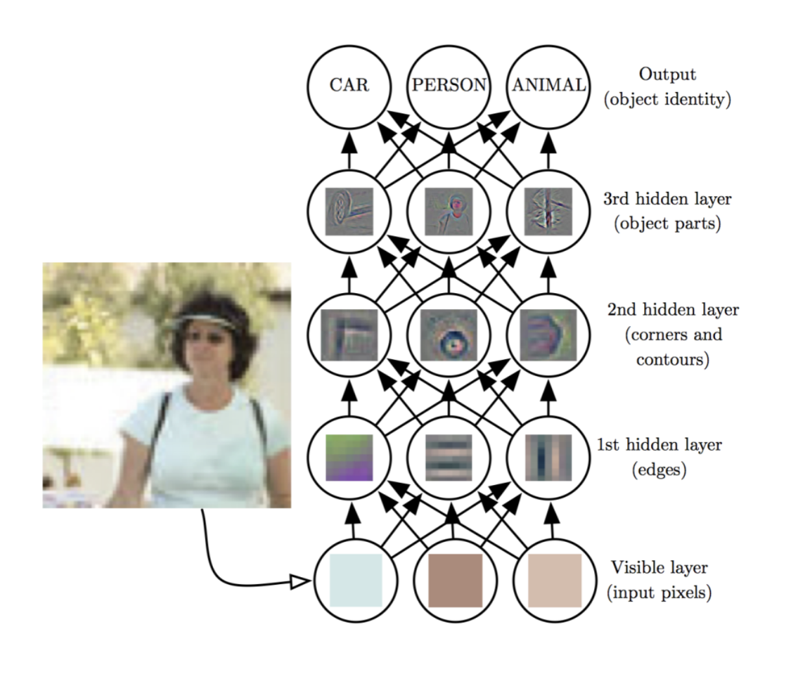

## What you will learn

Neural networks power image recognition, speech transcription, and large language models, but the core idea is surprisingly small. A neural net is a sequence of simple functions that are trained by repeatedly nudging their numbers in whichever direction that makes the error shrink. This activity will help you understand that idea, and apply it to image classification. By the end of this guide you will hopefully be able to:

1.  **Describe** what a dense NN or MLP computes: layers, weights, and activation functions.
2.  **Explain** how training works (loss function, gradient descent, backpropagation) and verify a gradient by hand.
3.  **Train** a logistic regression and an MLP on an image dataset in R using the `torch` package, and compare them.
4.  **Use** a train / validation / test split to tune a model.
5.  **Navigate** the bigger landscape: what other kinds of networks exist and which R tools you would use next.

## Part 0: Setup

We will use the [`torch`](https://torch.mlverse.org/) package, which gives R users the same engine that powers PyTorch, with no Python required. PyTorch is a widely used library for deep learning that was built for Python. We will also use `torchvision` for datasets and then, of course, tidyverse and ggplot for wrangling and plotting.

```{r}
#| label: install
# Run once and then comment out. You probably already have tidyverse and ggplot installed, so delete those if you'd like!
install.packages(c("torch", "torchvision", "tidyverse", "ggplot2"))
torch::install_torch() #if prompted, you may need to run this
```

```{r}
#| label: setup
library(torch)
library(torchvision)
library(tidyverse)
library(ggplot2)

torch_is_installed()   # check to see if this is TRUE
torch_manual_seed(456)
set.seed(456)
```

::: {.callout-tip title="Tip"}
If `torch_is_installed()` does not return `TRUE`, you may need to run `torch::install_torch()` again and restart R.
:::

## Part 1: Anatomy of a neural network

### Layers of simple functions

A neural network is composed of an input, a hidden layer, and an output. The hidden layer is composed of a collection of simple functions. Each layer in the hidden section will do two things:

1.  A **linear step**: The linear step acts like a simple linear function y = Wx + b. W is the weight matrix, a collection of numbers used to scale transform or evaluate data (our input) across different fields. B is bias, similar to the y intercept of a standard linear equation. It is added to the weighted sum of inputs before passing through the next non-linear step.
2.  A **non-linear step**: An *activation function* is applied to each output of the linear function, one at a time. The activation function decides how strong each node in a layer should fire, or pass a signal to the next layer.

For a network with two layers, the prediction is

$$
\hat{\mathbf{y}} = g^{(2)}\!\Big(\mathbf{W}^{(2)}\, g^{(1)}\!\big(\mathbf{W}^{(1)}\mathbf{x} + \mathbf{b}^{(1)}\big) + \mathbf{b}^{(2)}\Big)
$$

where $\mathbf{x}$ is the input, each $\mathbf{W}^{(l)}$ and $\mathbf{b}^{(l)}$ are the **weights and biases** the network will learn, and $g^{(l)}$ is the activation function. "Deep" learning just means more of these layers stacked up. In the image-recognition setting, early layers tend to pick up simple patterns (like edges) and later layers combine them into more abstract ones (like parts of objects). The math here isn't super important, but it's actually just stuff you already know!



### Why we need activation functions

Without the activation function, the whole network would collapse into one big matrix multiplication, which is just a linear model, no matter how many layers you stacked. **Activation functions adds the non-linearity that lets the network approximate complicated functions.** There are three common activation functions:

| Name | Formula | Notes |
|------------------------|------------------------|------------------------|
| Sigmoid | $g(z) = \dfrac{1}{1+e^{-z}}$ | ideal for binary classification, as it keeps output values between 0 and 1 |
| Tanh | $g(z) = \dfrac{e^{z}-e^{-z}}{e^{z}+e^{-z}}$ | maps any real number to a number between -1 and 1 |
| ReLU | $g(z) = \max(0, z)$ | the modern default for hidden layers |

again, the formulas aren't important to remember, but it is nice to see!

### Task 1.1: Plot them (3 min)

Run this, then **change something**: add `softplus` (`log(1 + exp(z))`), try a leaky ReLU, or zoom the x-axis. Which function has a flat region where the slope is nearly zero? (Hold that thought. It matters for training.)

```{r}
#| label: activations
tibble(z = seq(-5, 5, by = 0.05)) |>
  mutate(sigmoid = 1 / (1 + exp(-z)),
         tanh    = tanh(z),
         relu    = pmax(0, z)) |>
  pivot_longer(-z, names_to = "activation", values_to = "g_z") |>
  ggplot(aes(z, g_z, colour = activation)) +
  geom_line(linewidth = 1) +
  labs(title = "Common activation functions", y = "g(z)") +
  theme_minimal()
```

### The last layer decides the task

What the final layer and the loss look like depends on what you are predicting:

-   **Regression:** linear output ($g(z)=z$) with **squared loss** $\|\mathbf{y}-\hat{\mathbf{y}}\|^2$.
-   **Classification into** $K$ classes: a **softmax** turns the $K$ raw scores (called *logits*) into probabilities that sum to 1, and the **cross-entropy loss** punishes the model for giving low probability to the true class:

$$
\hat y_k = \frac{e^{z_k}}{\sum_{j=1}^{K} e^{z_j}}, \qquad
\mathcal{L}(\hat{\mathbf{y}}, y) = -\log \hat y_{y}
$$

We will do 10-class classification (digits 0–9), so softmax plus cross-entropy it is.

## Part 2: How a network learns (8 min)

### Training = minimizing a loss by walking downhill

Training means finding the weights $\mathbf{W}$ that minimize the average loss over the training data:

$$
J(\mathbf{W}) = \frac{1}{N}\sum_{n=1}^{N} \mathcal{L}\big(\hat{\mathbf{y}}^{(n)}, \mathbf{y}^{(n)}\big)
$$

The recipe is **gradient descent**:

1.  Initialize the weights randomly.
2.  Compute the gradient $\partial J / \partial \mathbf{W}$ (which direction increases the loss).
3.  Step the opposite way: $\mathbf{W} \leftarrow \mathbf{W} - \eta\, \partial J / \partial \mathbf{W}$, where $\eta$ is the **learning rate**.
4.  Repeat.

Two practical wrinkles:

-   **The loss surface is highly non-convex** and real networks have millions of weights, so we never expect to find the global minimum. We just want a *good* one.
-   Computing the gradient over all $N$ examples is expensive, so we use **stochastic gradient descent (SGD)**: estimate the gradient from a random **mini-batch** of examples at each step. It is noisy but cheap, and it parallelizes beautifully on GPUs. Variants like **momentum** and **Adam** adapt the step size automatically.

### Backpropagation: reusing work

A network can have millions of parameters, so we cannot compute each partial derivative from scratch. **Backpropagation** uses the chain rule to sweep from the output back toward the input, *reusing* the work from later layers. The cost of computing all the gradients is about the same as one forward pass. That efficiency is why the "matrix multiply, then element-wise activation" structure became the standard.

### Task 2.1: Do one backward pass by hand (5 min)

Here is a tiny regression network: 2 inputs, 2 hidden units with ReLU, 1 linear output, squared loss, and biases fixed at 0 to keep the arithmetic friendly.

-   Input $\mathbf{x} = (1, 2)$, target $y = 1$
-   $\mathbf{W}^{(1)} = \begin{pmatrix} 0.5 & -0.5 \\ 0.25 & 0.75 \end{pmatrix}$, $\quad \mathbf{W}^{(2)} = \begin{pmatrix} 1 & 2 \end{pmatrix}$

**On paper first (really!):**

a.  Compute the hidden pre-activations $\mathbf{z}^{(1)} = \mathbf{W}^{(1)}\mathbf{x}$, then apply ReLU to get $\mathbf{h}$.
b.  Compute $\hat y = \mathbf{W}^{(2)}\mathbf{h}$ and the loss $(y-\hat y)^2$.
c.  Work backward. The error signal at the output is $\delta^{(2)} = \partial \mathcal{L}/\partial \hat y = -2(y-\hat y)$. Then $\partial \mathcal{L}/\partial \mathbf{W}^{(2)} = \delta^{(2)}\,\mathbf{h}^\top$.
d.  Push the signal back through $\mathbf{W}^{(2)}$ and through the ReLU's derivative ($1$ if $z>0$, else $0$) to get $\delta^{(1)}$, then $\partial \mathcal{L}/\partial \mathbf{W}^{(1)} = \delta^{(1)}\,\mathbf{x}^\top$.

**Now let `torch` do it** with *automatic differentiation* (`autograd`), which is backpropagation done for you, and compare:

```{r}
#| label: autograd
x  <- torch_tensor(c(1, 2))
y  <- torch_tensor(1)

W1 <- torch_tensor(matrix(c(0.5, -0.5,
                            0.25, 0.75), nrow = 2, byrow = TRUE),
                   requires_grad = TRUE)
W2 <- torch_tensor(matrix(c(1, 2), nrow = 1), requires_grad = TRUE)

h     <- torch_relu(W1$matmul(x))   # hidden layer
y_hat <- W2$matmul(h)               # linear output
loss  <- (y - y_hat)^2

loss$backward()                     # <- backpropagation

loss; y_hat
W2$grad
W1$grad
```

::: {.callout-tip collapse="true" title="Check your hand calculation"}
$\mathbf{z}^{(1)} = (-0.5,\ 1.75)$, so $\mathbf{h} = (0,\ 1.75)$. Then $\hat y = 3.5$ and the loss is $6.25$.

$\delta^{(2)} = -2(1-3.5) = 5$, so $\partial\mathcal{L}/\partial\mathbf{W}^{(2)} = (0,\ 8.75)$.

Pushing back: $\delta^{(2)}\mathbf{W}^{(2)} = (5, 10)$, and the ReLU derivative is $(0, 1)$ because the first pre-activation was negative. So $\delta^{(1)} = (0, 10)$ and

$$\partial\mathcal{L}/\partial\mathbf{W}^{(1)} = \begin{pmatrix} 0 & 0 \\ 10 & 20 \end{pmatrix}.$$

Notice the first hidden unit got **zero gradient**. It was "off" for this input, so its weights learn nothing from this example. Keep an eye out for this later: units that are off for *every* input are sometimes called dead units.
:::

**Make it yours:** change the input, weights, or target to your favorite numbers. Predict the gradients on paper, then check. Try making both hidden pre-activations negative. What happens to every gradient in $\mathbf{W}^{(1)}$?

::: {.callout-important title="Checkpoint"}
You should be able to say, in your own words: *what does `loss$backward()` compute, and what would we do with those numbers next?* (Answer: the gradient of the loss with respect to every weight; we would subtract a small multiple of it from each weight.)
:::

## Part 3: Meet the data (5 min)

We will classify **MNIST**: 28 × 28 greyscale images of handwritten digits. The same code will work on two other datasets with a one-line change.

::: {.callout-note title="Pick your dataset (personalization #1)"}
`mnist_dataset` is the classic handwritten digits. **`fashion_mnist_dataset`** has 10 types of clothing (shirts, sneakers, bags...). **`kmnist_dataset`** has 10 handwritten Japanese Hiragana characters. Pick whichever sounds most fun and swap the function name in the chunk below. Everything after this works unchanged.
:::

```{r}
#| label: load-data
ds_fun <- mnist_dataset          # try fashion_mnist_dataset or kmnist_dataset

train_ds <- ds_fun("data", train = TRUE,  download = TRUE)
test_ds  <- ds_fun("data", train = FALSE, download = TRUE)

class_names <- train_ds$classes
```

The raw data is a big array of pixel intensities (0–255). Before modeling we do three things:

1.  Rescale to $[-1, 1]$. Networks train better when inputs are on a standard scale (this is *input standardization*).
2.  **Flatten** each 28 × 28 image into a vector of 784 numbers, since a dense layer expects a vector.
3.  Split into **training**, **validation**, and **test** sets (more on why in a moment).

```{r}
#| label: prep-data
prep_x <- function(arr) {
  t <- torch_tensor(as.array(arr))$to(dtype = torch_float()) / 255
  t <- (t - 0.5) / 0.5
  t$view(c(-1, 784))
}
prep_y <- function(labels) torch_tensor(as.integer(labels), dtype = torch_long())

x_all <- prep_x(train_ds$data);  y_all <- prep_y(train_ds$targets)
x_test <- prep_x(test_ds$data);  y_test <- prep_y(test_ds$targets)

# 50,000 train / 10,000 validation
train_idx <- sample(60000, 50000)
val_idx   <- setdiff(1:60000, train_idx)

x_train <- x_all[train_idx, ]; y_train <- y_all[train_idx]
x_val   <- x_all[val_idx, ];   y_val   <- y_all[val_idx]

x_train$shape   # 50000 784
```

::: {.callout-warning title="R gotcha: labels start at 1"}
R counts from 1, and so does `torch` for R. Class labels run **1–10**, not 0–9. For MNIST, the digit is `label - 1`. Rely on `class_names[label]` to translate.
:::

### 🛠 Task 3.1: Look at your data (3 min)

```{r}
#| label: show-digits
digits_long <- function(x, y, idx) {
  map_dfr(idx, function(i) {
    tibble(id    = i,
           label = class_names[as_array(y[i])],
           row   = rep(1:28, each = 28),
           col   = rep(1:28, times = 28),
           value = as_array(x[i, ]))
  })
}

digits_long(x_train, y_train, sample(50000, 12)) |>
  mutate(panel = paste0("#", id, ": ", label)) |>
  ggplot(aes(col, row, fill = value)) +
  geom_raster() +
  scale_y_reverse() +
  scale_fill_gradient(low = "white", high = "black") +
  coord_equal() +
  facet_wrap(~ panel) +
  theme_void() +
  theme(legend.position = "none")
```

**Make it yours:** which class do *you* think will be hardest to tell apart from another? Write your guess down. We will check it at the end of Part 4.

## Part 4: Baseline: multi-class logistic regression (8 min)

Before building anything fancy, always train a simple baseline. A multi-class logistic regression is just a **neural network with no hidden layer**: one linear layer producing 10 scores, then softmax.

```{r}
#| label: logreg-model
logreg <- nn_sequential(nn_linear(784, 10))
```

Because `nnf_cross_entropy()` applies the softmax internally, the model outputs raw **logits**, and we give them directly to the loss. (This is numerically safer than computing probabilities and then taking logs yourself.)

### The training loop

Every `torch` training loop has the same five beats. Fill in the three missing lines marked `YOUR CODE HERE`:

```{r}
#| label: train-model
evaluate <- function(model, x, y) {
  model$eval()
  with_no_grad({
    out <- model(x)
    tibble(loss = nnf_cross_entropy(out, y)$item(),
           acc  = (out$argmax(dim = 2) == y)$to(dtype = torch_float())$mean()$item())
  })
}

train_model <- function(model, x_tr, y_tr, x_va, y_va,
                        epochs = 5, lr = 1e-3, batch_size = 128,
                        optimizer = optim_adam, ...) {
  dl  <- dataloader(tensor_dataset(x_tr, y_tr),
                    batch_size = batch_size, shuffle = TRUE)
  opt <- optimizer(model$parameters, lr = lr, ...)
  history <- tibble()

  for (epoch in seq_len(epochs)) {
    model$train()
    coro::loop(for (batch in dl) {
      opt$zero_grad()                 # 1. reset old gradients
      out <- model(batch[[1]])        # 2. forward pass: logits for this mini-batch

      # YOUR CODE HERE: 3. compute the cross-entropy loss (out vs. batch[[2]])
      # YOUR CODE HERE: 4. backpropagate
      # YOUR CODE HERE: 5. take an optimizer step
    })

    tr <- evaluate(model, x_tr, y_tr)
    va <- evaluate(model, x_va, y_va)
    history <- bind_rows(history,
      tibble(epoch = epoch,
             train_loss = tr$loss, train_acc = tr$acc,
             val_loss   = va$loss, val_acc   = va$acc))
    cat(sprintf("epoch %2d | train loss %.3f | val loss %.3f | val acc %.3f\n",
                epoch, tr$loss, va$loss, va$acc))
  }
  history
}
```

::: {.callout-tip collapse="true" title="Stuck? Peek at the three lines"}
``` r
loss <- nnf_cross_entropy(out, batch[[2]])
loss$backward()
opt$step()
```

Why `zero_grad()` first? `torch` *accumulates* gradients into `$grad` each time you call `backward()`, so you must clear the old ones every iteration.
:::

Now train it. An **epoch** is one full pass through the training data.

```{r}
#| label: train-logreg
torch_manual_seed(1)
logreg <- nn_sequential(nn_linear(784, 10))
hist_logreg <- train_model(logreg, x_train, y_train, x_val, y_val, epochs = 5)
```

### 🛠 Task 4.1: What did the model learn? (4 min)

A logistic regression has one weight per pixel per class, so we can literally *look at* what each class is searching for:

```{r}
#| label: logreg-weights
W <- as_array(logreg[[1]]$weight)   # 10 x 784

map_dfr(1:10, function(k) {
  tibble(class = class_names[k],
         row   = rep(1:28, each = 28),
         col   = rep(1:28, times = 28),
         weight = W[k, ])
}) |>
  ggplot(aes(col, row, fill = weight)) +
  geom_raster() +
  scale_y_reverse() +
  scale_fill_gradient2(low = "firebrick", mid = "white", high = "steelblue") +
  coord_equal() +
  facet_wrap(~ class) +
  theme_void()
```

Blue pixels vote *for* a class and red pixels vote *against* it. Do you see the shapes? Then compute a quick confusion table on the validation set to check your Part 3 guess about which classes get mixed up:

```{r}
#| label: confusion
pred <- as_array(logreg(x_val)$argmax(dim = 2))
tibble(truth = class_names[as_array(y_val)], pred = class_names[pred]) |>
  count(truth, pred) |>
  ggplot(aes(pred, truth, fill = n)) +
  geom_tile() +
  scale_fill_viridis_c(trans = "sqrt") +
  theme_minimal() +
  theme(axis.text.x = element_text(angle = 45, hjust = 1))
```

::: {.callout-important title="Checkpoint"}
Write down your baseline's final validation accuracy. For MNIST it is typically around 92%. **That number is what the MLP has to beat.**
:::

## Part 5: Your first MLP (7 min)

Now add **hidden layers with ReLU activations**. We will use 784 → 128 → 64 → 10:

```{r}
#| label: mlp-model
torch_manual_seed(1)
mlp <- nn_sequential(
  nn_linear(784, 128), nn_relu(),
  nn_linear(128, 64),  nn_relu(),
  nn_linear(64, 10)                 # logits; softmax lives inside the loss
)

mlp   # print the architecture

# How many learnable numbers? (logistic regression had 7,850)
sum(map_dbl(mlp$parameters, \(p) p$numel()))
```

That is 109,386 weights and biases, about 14 times more than the baseline. Because we wrote `train_model()` generically, training the MLP takes **zero new code**:

```{r}
#| label: train-mlp
hist_mlp <- train_model(mlp, x_train, y_train, x_val, y_val, epochs = 10)
```

### 🛠 Task 5.1: Compare (3 min)

Plot both models' validation loss and accuracy on the same axes:

```{r}
#| label: compare
bind_rows(logreg = hist_logreg, mlp = hist_mlp, .id = "model") |>
  pivot_longer(c(train_loss, val_loss, train_acc, val_acc),
               names_to = c("split", "metric"), names_sep = "_") |>
  ggplot(aes(epoch, value, colour = model, linetype = split)) +
  geom_line(linewidth = 1) +
  facet_wrap(~ metric, scales = "free_y") +
  theme_minimal()
```

Discuss with your partner (or jot down your answers):

-   How much better is the MLP? Where do the training and validation curves start to **separate**? That gap is **overfitting**: the model is memorizing the training set rather than learning something general.
-   The MLP has 14 times more parameters. Was that extra capacity worth it?

## Part 6: Your experiment (10 min)

Now you are the researcher. Pick **one question** you are curious about, run **at least three variants**, and plot the results. Here is a reusable model builder, plus a menu of ideas.

```{r}
#| label: make-mlp
make_mlp <- function(hidden = c(128, 64), dropout = 0, batch_norm = FALSE,
                     n_in = 784, n_out = 10) {
  layers <- list(); prev <- n_in
  for (h in hidden) {
    layers <- c(layers, list(nn_linear(prev, h)))
    if (batch_norm) layers <- c(layers, list(nn_batch_norm1d(h)))
    layers <- c(layers, list(nn_relu()))
    if (dropout > 0) layers <- c(layers, list(nn_dropout(dropout)))
    prev <- h
  }
  do.call(nn_sequential, c(layers, list(nn_linear(prev, n_out))))
}
```

::: {.callout-note title="Pick your question (personalization #2)"}
| If you're curious about... | Try varying... |
|------------------------------------|------------------------------------|
| **Size:** is bigger always better? | `hidden = c(16)`, `c(128, 64)`, `c(512, 256, 128)` |
| **Learning rate:** how sensitive is training? | `lr = 1e-4, 1e-3, 1e-2, 1e-1` |
| **Optimizers:** does Adam really help? | `optimizer = optim_sgd` vs. `optim_sgd, momentum = 0.9` vs. `optim_adam` |
| **Regularization:** can we shrink the train/val gap? | `dropout = 0, 0.2, 0.5`, or L2 via `weight_decay = 0, 1e-4, 1e-3` |
| **Data hunger:** how much data do we need? | train on only 500, 5,000, 50,000 images |
| **Datasets:** which is harder, digits, clothes, or Hiragana? | swap `ds_fun` in Part 3 and rerun |
:::

Here is a complete example sweeping the learning rate. Modify it to answer *your* question:

```{r}
#| label: experiment
results <- map_dfr(c(1e-4, 1e-3, 1e-2, 1e-1), function(lr) {
  torch_manual_seed(1)
  model <- make_mlp()
  train_model(model, x_train, y_train, x_val, y_val, epochs = 5, lr = lr) |>
    mutate(setting = paste("lr =", lr))
})

ggplot(results, aes(epoch, val_acc, colour = setting)) +
  geom_line(linewidth = 1) +
  labs(title = "Validation accuracy by learning rate", y = "validation accuracy") +
  theme_minimal()
```

::: {.callout-tip collapse="true" title="Hints for other experiments"}
-   **Dropout** randomly zeroes a fraction of activations *during training only*. `train_model()` already calls `model$train()` / `model$eval()` for you, so evaluation uses the full network automatically.
-   **Weight decay** is L2 regularization. Pass it through `...`: `train_model(model, ..., weight_decay = 1e-3)`.
-   **Optimizer with momentum:** `train_model(model, ..., optimizer = optim_sgd, lr = 0.05, momentum = 0.9)`.
-   **Less data:** `train_model(model, x_train[1:500, ], y_train[1:500], x_val, y_val)`. Watch the train/val gap explode.
:::

### 🏁 Finish line

You have been choosing models by looking at the **validation** set. That is exactly what it is for. But after all that tuning, your validation score is slightly optimistic, because *you* picked the winner using it. The **test set** is the one you have not touched, and you get to use it **once**, at the very end:

```{r}
#| label: finish-line
# Retrain your best configuration, then:
best_model <- make_mlp()   # <- put your winning settings here
train_model(best_model, x_train, y_train, x_val, y_val, epochs = 10)

evaluate(best_model, x_test, y_test)
```

**You are done with the basic guide when you can fill in this sentence:**

> *"On \[dataset\], my best model was \_\_\_\_\_\_ (settings), which reached \_\_\_\_% validation accuracy and \_\_\_\_% test accuracy. Compared with the logistic regression baseline, the biggest lesson from my experiment was \_\_\_\_\_\_."*

::: {.callout-important title="Why not just tune on the test set?"}
If you repeatedly peek at the test set, your choices start to fit *its* quirks, and the reported accuracy no longer tells you how the model will do on genuinely new data. Training set: fit the weights. Validation set: choose hyperparameters. Test set: report the final honest number.
:::

## Part 7: Optional advanced challenges

Finished early, or just curious? Pick any of these. They are independent of each other.

### Challenge A: Early stopping

Rather than guessing the number of epochs, stop when validation loss stops improving ("with some look-ahead," called *patience*) and restore the best weights. Modify `train_model()` to take `epochs = 50, patience = 3`.

::: {.callout-tip collapse="true" title="Sketch of one solution"}
Before the epoch loop add `best_val <- Inf; wait <- 0`. After computing `va`:

``` r
if (va$loss < best_val) {
  best_val   <- va$loss
  wait       <- 0
  best_state <- lapply(model$state_dict(), \(t) t$clone())
} else {
  wait <- wait + 1
  if (wait >= patience) break
}
```

and after the loop, `model$load_state_dict(best_state)`.
:::

### Challenge B: Hunt for dead units

Do all 128 first-layer units pull their weight? Look at the first hidden layer's activations on the validation set. A unit whose activation barely varies across images contributes almost nothing.

```{r}
#| label: dead-units
h1 <- mlp[[2]](mlp[[1]](x_val))             # ReLU(first linear layer)
unit_var <- as_array(h1$var(dim = 1))       # variance across images, per unit

tibble(unit = seq_along(unit_var), variance = unit_var) |>
  ggplot(aes(unit, variance)) + geom_col() + theme_minimal()

sum(unit_var <= 0.1)   # how many units look inactive?
```

Now rebuild the network with a much smaller first layer (e.g., 75 units) and compare the number of inactive units in layer 1 versus layer 2. Then use `backward()` on one mini-batch and compare histograms of `model[[1]]$weight$grad` against the final layer's gradient. You should find that gradients are typically larger near the output, which is one reason the early layers can be slower to train.

### Challenge C: Which pixels mattered? (feature explainability)

A *saliency map* asks: "if I nudged each input pixel slightly, how much would the model's top score change?" That is just the gradient of the winning logit with respect to the **input**, and `autograd` hands it to you for free:

```{r}
#| label: saliency
i <- 7
x <- x_test[i, , drop = FALSE]$clone()$requires_grad_(TRUE)

out <- mlp(x)
cls <- as_array(out$argmax(dim = 2))
out[1, cls]$backward()

sal <- abs(as_array(x$grad[1, ]))

tibble(row = rep(1:28, each = 28), col = rep(1:28, times = 28), saliency = sal) |>
  ggplot(aes(col, row, fill = saliency)) +
  geom_raster() + scale_y_reverse() + coord_equal() +
  scale_fill_viridis_c() + theme_void() +
  labs(title = paste("Model says:", class_names[cls],
                     "| truth:", class_names[as_array(y_test[i])]))
```

Try it on an image the model gets *wrong*. Does the saliency map suggest why?

### Challenge D: Save and reload a model

Training is expensive, so you rarely want to repeat it. Save the learned parameters (the `state_dict`), then load them into a fresh network:

```{r}
#| label: save-load
torch_save(mlp$state_dict(), "mlp_checkpoint.pt")

fresh <- make_mlp()
fresh$load_state_dict(torch_load("mlp_checkpoint.pt"))
evaluate(fresh, x_val, y_val)
```

Now try loading the same checkpoint into `make_mlp(hidden = c(256, 128))`. What happens, and why does it make sense?

### Challenge E: The tidymodels route

You just wrote everything by hand to see how it works. For quick tabular problems in R, you can fit small networks through the tidymodels `mlp()` specification (for example with the `nnet` or `brulee` engines). Pick a dataset you have used in this class, fit an `mlp()`, and compare it with a random forest or linear model. See the `parsnip` documentation for the current engine options.

## Where to go from here

You built a **dense** network: every unit in one layer connects to every unit in the next. It treats the 784 pixels as an unordered bag of numbers. Different data has structure worth exploiting, which is why other architectures exist:

| Data | Architecture family | Key idea |
|------------------------|------------------------|------------------------|
| Images | Convolutional networks (CNNs) | reuse the same small filters across the whole image, exploiting spatial correlation |
| Text, audio, time series | Recurrent networks and **transformers** | handle sequences of variable length |
| Large-scale language and image generation | Large transformer models | the same training ideas (loss, gradients, backprop) at enormous scale |

The ingredients you practiced today (a loss function, gradient descent, backpropagation, train/validation/test splits, regularization) carry over to all of them. In particular, scale in data and compute matters a great deal: AlexNet's 2012 ImageNet win used a CNN with about 60 million parameters, trained on GPUs.

**R toolbox for next steps:**

-   [`torch`](https://torch.mlverse.org/): what you used today; supports CNNs, transformers, custom training loops.
-   [`keras3`](https://keras3.posit.co/): a higher-level interface that is quick for standard architectures.
-   [`tidymodels`](https://www.tidymodels.org/): `mlp()` for small networks inside the workflow you already know.
-   Free book: *Deep Learning and Scientific Computing with R torch* (Sigrid Keydana).

## Cheat sheet

| Idea | One-liner |
|------------------------------------|------------------------------------|
| Layer | linear map + bias, then a non-linear activation |
| Activation | the thing that makes depth useful (ReLU is the usual hidden-layer default) |
| Softmax + cross-entropy | turn scores into probabilities; punish low probability on the true class |
| Gradient descent | $\mathbf{W} \leftarrow \mathbf{W} - \eta\,\partial J/\partial \mathbf{W}$ |
| SGD / mini-batch | estimate the gradient on a small random batch |
| Backprop (`$backward()`) | chain rule, output → input, reusing work |
| Epoch | one full pass over the training data |
| Overfitting | train performance keeps improving, validation performance does not |
| Early stopping, L2 (`weight_decay`), dropout | three ways to rein in overfitting |
| Train / validation / test | fit weights / choose settings / report the final number once |
| Training loop | `zero_grad()`, forward, loss, `backward()`, `step()` |

## Credits and further reading

This guide synthesizes and adapts material from a neural networks course taught at Universidad Carlos III de Madrid:

-   Lecture slides *Deep learning with Neural Networks* by Alejandro Lancho Serrano and Pablo Martínez Olmos, which themselves draw on MIT 6.S191: Introduction to Deep Learning (introtodeeplearning.com), *Deep Learning* by Goodfellow et al. (2017), and figures by Sebastian Raschka (sebastianraschka.com).
-   Lab *Image classification with MLPs* by Pablo M. Olmos (Python/PyTorch), itself a wrap-up of Facebook's Deep Learning course on Udacity. The structure of Parts 3–5 follows that lab, translated to R.
-   Krizhevsky, Sutskever & Hinton (2012), *ImageNet Classification with Deep Convolutional Neural Networks*.
-   `torch` for R: <https://torch.mlverse.org/>

------------------------------------------------------------------------

# Test-drive notes {.unnumbered}

<!-- TODO (team): After each test session, paste the tester's session notes here. Keep each person's notes separate, as the assignment asks. -->

## Session 1 {.unnumbered}

-   **Team member running the session:**
-   **Tester (name / background):**
-   **Date and total time taken:**
-   **Where they got stuck or confused (with timestamps / task numbers):**
-   **Where we had to step in:**
-   **Answer to: "How well did you learn what we said you would learn?"**
-   **Answer to: "Was anything confusing?"**
-   **Answer to: "Is there anything you wish you had learned?"**

## Session 2 {.unnumbered}

*(same template)*

## Session 3 {.unnumbered}

*(same template)*

# How we improved the guide {.unnumbered}

<!-- TODO (team): After comparing notes, describe each change and the feedback that motivated it. -->

| Feedback we received | Change we made |
|----------------------|----------------|
|                      |                |
|                      |                |
